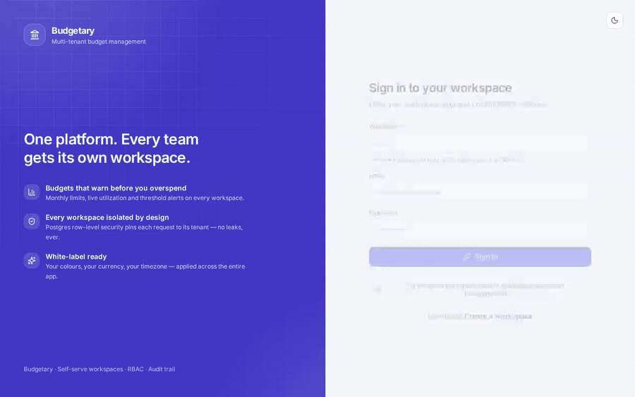
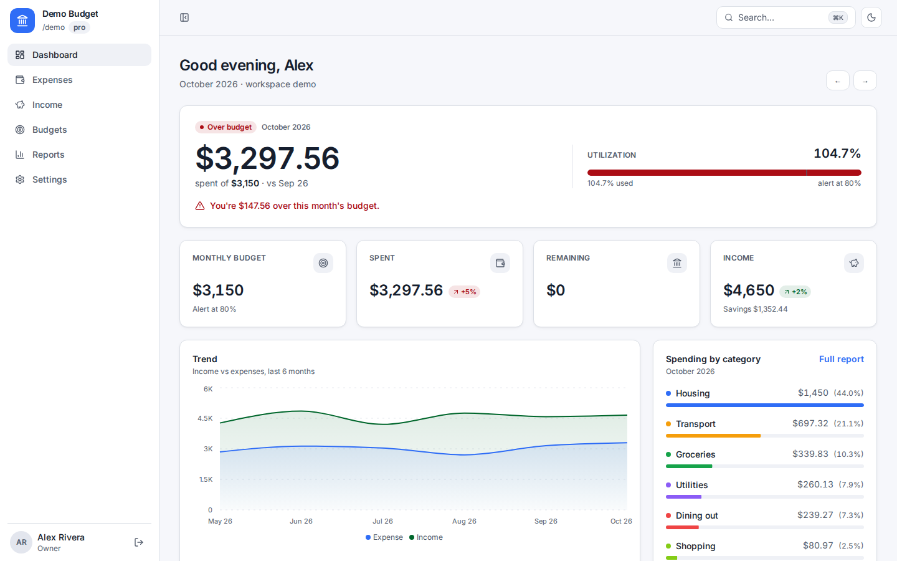
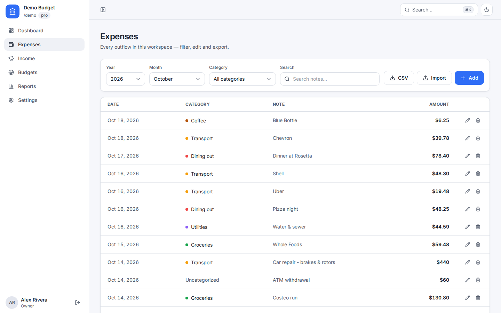
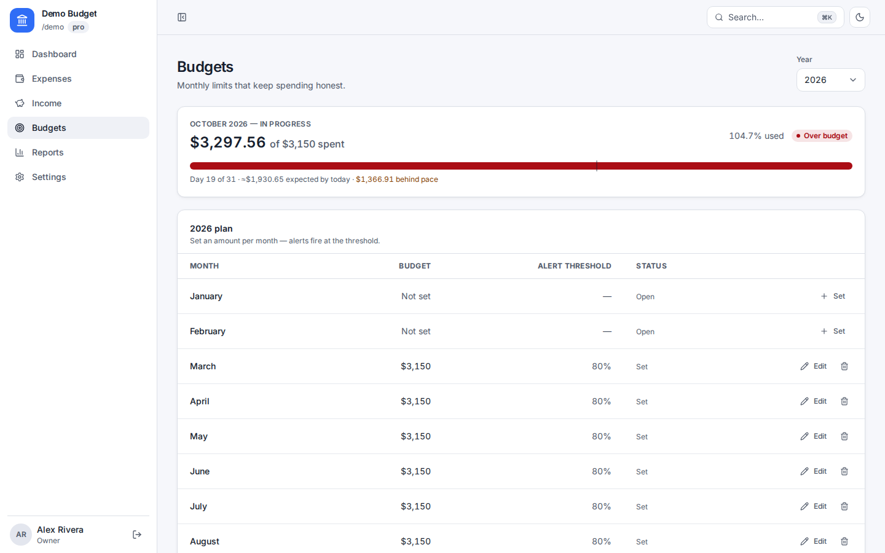
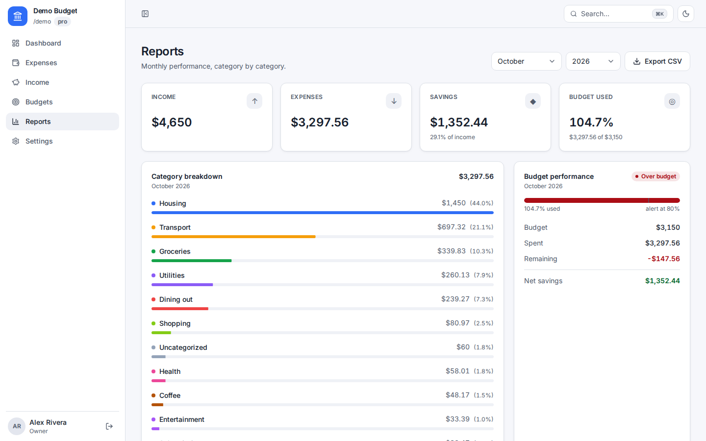
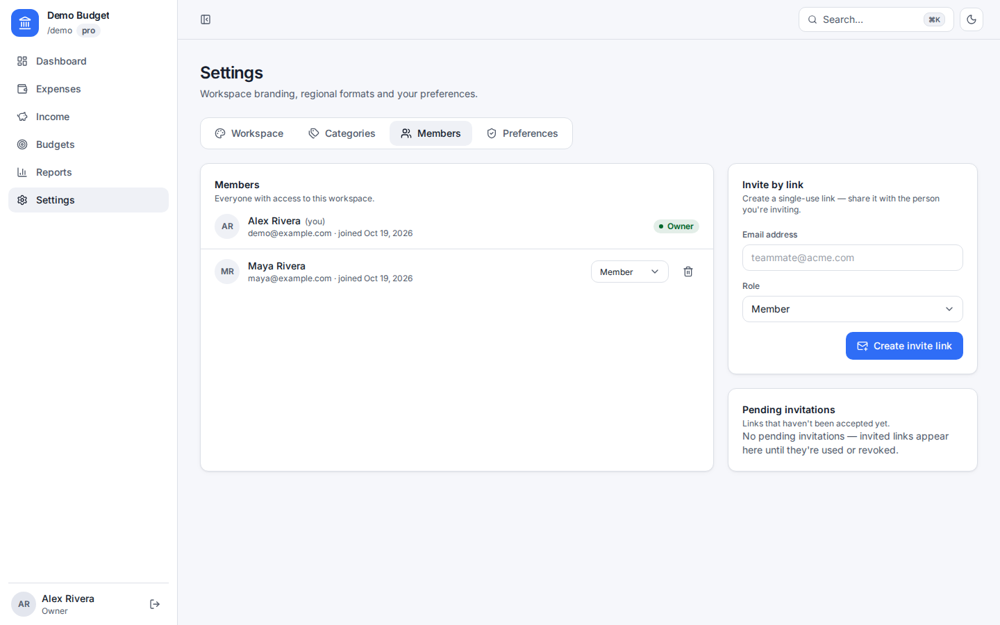
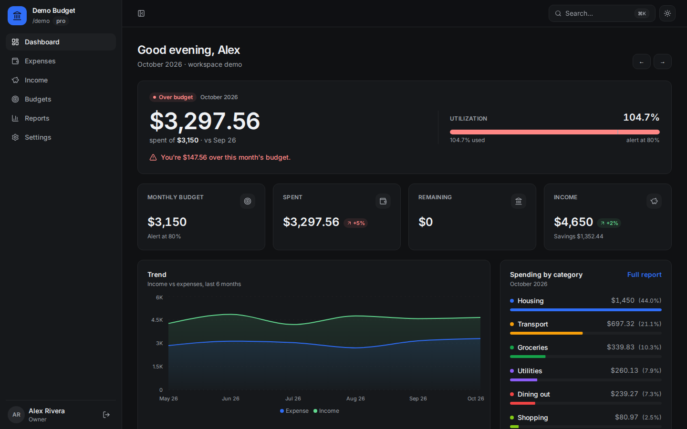
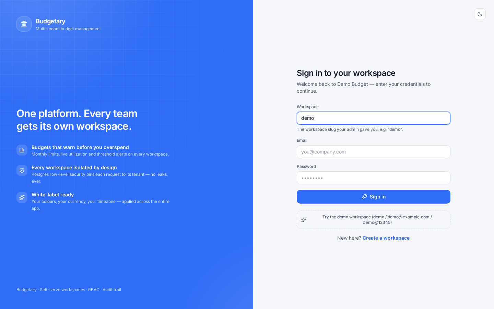
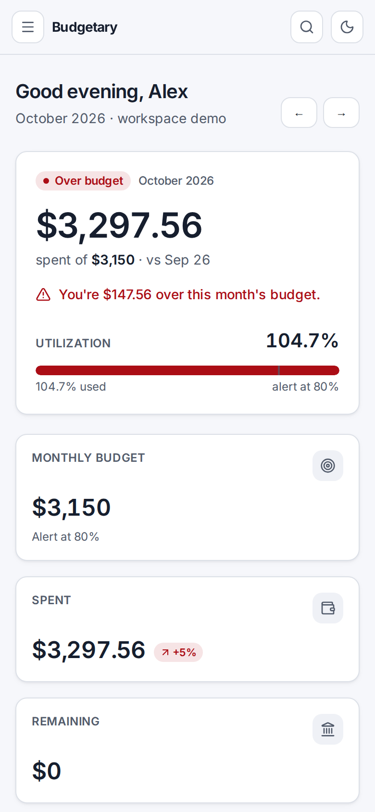

# Budgetary

**A self-hosted budgeting workspace where every team gets its own private, branded space.**

[](./LICENSE)
[](./backend/tests)
[](./docs/ARCHITECTURE.md)
[](./docker-compose.yml)



**[Watch the 20-second demo](./docs/assets/demo.mp4)** · **[Try the interactive tour](#publish-the-interactive-tour)** · **[Quick start](#quick-start)** · **[For buyers](#for-buyers)** · **[Beginner guide](#-beginner-guide--read-this-and-you-are-a-professional)**

---

## The 30-second version

Budgetary is a complete budgeting SaaS you can run yourself. A household, a
small business, a studio or any team signs up, gets a private workspace, and
starts tracking money in minutes.

- **For:** households, small teams and operators who share money and need
  separate logins, clear roles and real privacy.
- **What you get:** budgets, expenses, income, categories, monthly and yearly
  reports, CSV import/export, invitations, four roles, per-workspace branding,
  currency, locale, timezone, light/dark themes and an audit trail.
- **Why it is different:** isolation is enforced by PostgreSQL row-level
  security, not by a promise in the UI. A dedicated non-superuser database role
  is used on request paths, and cross-tenant access is covered by tests.
- **What it costs:** the source is MIT licensed. There are no seat fees, no
  usage metering, no external analytics and no API keys. You pay only for the
  machine you run it on.
- **Status:** release candidate, verified **19 October 2026** — 38 backend
  tests, a production frontend build and a black-box end-to-end API run.

## Quick start

You need Docker with Compose. Nothing else — no cloud account, no API key.

```bash
cp .env.example .env          # optional: change secrets and ports
docker compose up --build -d  # Postgres + API + web + edge
```

Open **http://localhost** (or the port you set in `.env`) and sign in with the
seeded demo workspace:

| Workspace | Email | Password | Role |
| --- | --- | --- | --- |
| `demo` | `demo@example.com` | `Demo@12345` | Owner |
| `demo` | `maya@example.com` | `Demo@12345` | Member |

The demo tells an eight-month story: Alex and Maya Rivera tracking a
**$3,150 monthly budget** with **15 categories**, **243 expenses** and
**23 income deposits**. The current month is deliberately over budget, so
every status, chart and warning has something real to show.

Create your own workspace from **Register**, or reset the demo at any time:

```bash
docker compose exec backend python -m scripts.seed_demo --force
```

`make up`, `make test-backend`, `make test-e2e` and `make seed` wrap the same
commands if you prefer shortcuts.

> **Prefer to look before you install?** The screenshots below show the real
> product, and the self-contained tour in [`docs/preview.html`](./docs/preview.html)
> adds a budget simulator, a buyer calculator and a ten-question
> scratch-to-pro quiz. See [Publish the interactive tour](#publish-the-interactive-tour).

## Choose your path

| You are… | Start here |
| --- | --- |
| A business buyer or decision maker | [For buyers](#for-buyers) · [10-minute evaluation](#ten-minute-evaluation) · [Business case](./docs/BUSINESS-CASE.md) |
| A household or team that wants to use it | [Quick start](#quick-start) · [Five-minute tour](#a-five-minute-tour) · [FAQ](#faq) |
| A developer evaluating the architecture | [How it works](#how-it-works) · [Security and trust](#security-and-trust) · [Testing](#testing-and-verification) |
| A beginner who wants to understand SaaS | [🌱 Beginner guide](#-beginner-guide--read-this-and-you-are-a-professional) |
| Someone publishing the demo page | [Publish the interactive tour](#publish-the-interactive-tour) |

---

## Screenshots

| Dashboard | Expenses |
| --- | --- |
|  |  |

| Budgets | Reports |
| --- | --- |
|  |  |

| Members and roles | Dark mode |
| --- | --- |
|  |  |

| Branded sign-in | On a phone |
| --- | --- |
|  |  |

The images above are real screens from the seeded demo. The interactive tour
also includes income, members and roles, a branded sign-in page, dark mode and
a mobile view, all with a keyboard-accessible lightbox.

---

## For buyers

Budgetary is built for the moment a shared spreadsheet stops being enough:
two or more people need the same numbers, different levels of access, and a
clear answer to “are we okay this month?” without passing a login around.

### What changes when money lives in one place

| The problem today | What Budgetary gives you | Where to see it |
| --- | --- | --- |
| One shared spreadsheet, one shared password | A private workspace, individual logins and four enforced roles | [Members and roles](#features-and-user-stories) |
| “Did we already pay that?” | Searchable expenses and income with filters, totals and pagination | [Five-minute tour](#a-five-minute-tour) |
| Month-end panic | A single monthly limit, alert threshold, status badge and spending-pace line | [Budget math](#how-the-money-math-works) |
| Reports rebuilt by hand | Monthly and yearly category reports plus a six-month trend | [Reports](#features-and-user-stories) |
| Migration fear | CSV import with header aliases, duplicate skipping and row-level errors | [CSV import](#features-and-user-stories) |
| A generic tool with someone else’s logo | Per-workspace name, accent colour, logo URL, currency, locale and timezone | [Branding](#features-and-user-stories) |
| Security review asks | Forced row-level security, a non-superuser app role, rotating sessions, audit logs and tests | [Security and trust](#security-and-trust) |
| Vendor lock-in | MIT source, PostgreSQL, Docker Compose and a documented API | [License](#license) |

### Who it is for

- **Households and couples** who want a shared budget but separate logins.
- **Small businesses and studios** that need private books per team, project
  or client workspace.
- **Operators and finance leads** replacing a spreadsheet ritual with a
  repeatable monthly process.
- **Privacy-sensitive teams** that want the data on their own machine, with no
  external analytics or AI calls.
- **Developers and learners** who want a real, tested multi-tenant reference
  instead of another todo-list tutorial.

### What you get for the price

The software is **MIT licensed**. You can use it privately, inside a company,
or as part of a commercial service. There are no per-seat fees, no workspace
caps in the code and no paid tier. Your ongoing cost is the server, backups and
the time you choose to invest.

If you need a managed service, custom branding or an implementation partner,
those are services you can buy or provide separately — the MIT licence does not
oblige anyone to offer them.

### What it does not do

Honest boundaries are part of a good evaluation:

- No direct bank sync. CSV import is the supported path.
- One monthly budget limit per workspace; not an envelope budget with many
  independent pots.
- No receipt OCR, bank feeds, investment tracking or tax filing.
- No native iOS/Android app; the web app is responsive and works in a mobile
  browser.
- No SSO/SAML or SCIM in this build.
- The built-in rate limiter is in-process. Run one API replica, or move the
  limiter to Redis before scaling horizontally.
- It is self-hosted software, not a hosted service with a support contract.

### Ten-minute evaluation

1. Run the [quick start](#quick-start) and sign in as Alex.
2. Confirm the dashboard shows **$3,297.56 spent of $3,150** for the current
   month, with an over-budget status and a pace warning.
3. Add an expense, edit it, delete it, then search for `rent`.
4. Change the monthly budget and use **Undo** in the toast.
5. Export a CSV, then re-import it with **skip duplicates** on.
6. Open **Settings → Members**, create an invite link and accept it in a
   private window.
7. Change the workspace display name, accent colour and currency; watch the
   sidebar, sign-in page and number formatting follow.
8. Sign in as Maya and confirm the member view.
9. Open **Reports**, switch monthly/yearly, and read the category shares.
10. Run the backend tests and the end-to-end script from
    [Testing](#testing-and-verification).

If those ten steps match how your team works, you have a fit. If they do not,
the [limitations](#what-it-does-not-do) above are the honest reasons to stop.

---

## Features and user stories

### Money tracking

- As a household member, I can add an expense with a category, note and date in
  seconds, so the shared picture stays current.
- I can search notes, filter by year, month and category, and page through
  results with totals, so I can find any transaction without a spreadsheet.
- I can edit or delete an entry with confirmation, so mistakes are fixable.
- I can record income alongside expenses, so the month reflects money in as
  well as money out.
- I can manage categories in Settings, so the structure matches my life rather
  than a generic starter list.

### Budgets that answer “how am I doing?”

- As a budget owner, I can set one monthly limit with an alert threshold, so the
  workspace knows when to warn me.
- The dashboard shows utilisation, remaining balance and a status badge
  (on track / approaching / over), so I never have to do the maths.
- A spending-pace line compares today’s spend with where the month should be,
  so spending ahead of or behind the month’s rhythm is visible before the month
  ends.
- I can undo a budget change from the toast, so a mistyped number is not
  permanent.

### Reports and files

- Monthly and yearly reports break spending down by category with shares and a
  six-month income-vs-expense trend.
- One click exports transactions to CSV; export filenames include the month.
- CSV import accepts our own export format and common header aliases, shows
  row-level errors, skips duplicates, and creates missing categories.
- Exported spreadsheets are protected against formula injection.

### Workspaces, people and roles

- Self-serve registration creates a workspace, an owner and sensible default
  categories in one step.
- Owners and admins invite people by link; each person gets their own login.
- Four roles: **owner**, **admin**, **member** and **viewer**. Viewers are
  read-only, and the API enforces every rule — not just the UI.
- Owners cannot be removed or re-roled, and nobody can change their own role.
- Every workspace has its own display name, accent colour, logo URL, currency,
  locale and timezone.
- The sign-in page is themed from the workspace slug *before* authentication,
  so customers see their own brand from the first screen.
- Light and dark themes, a collapsible sidebar and a ⌘K / Ctrl-K command palette
  make the app quick to navigate.

### Security and operations

- PostgreSQL row-level security is enabled **and forced** on every tenant table;
  a dedicated non-superuser app role cannot bypass it.
- Tenant context is pinned per transaction, so a missing `WHERE` clause still
  cannot leak another workspace’s rows.
- Short-lived access tokens, rotating refresh tokens with reuse detection,
  bcrypt password hashing, and refresh tokens in HttpOnly cookies.
- Per-tenant (or per-IP) rate limiting, stricter credential-endpoint limits,
  security headers and HSTS at the edge.
- Append-only audit logs record logins, money changes, imports, role changes
  and branding updates.
- Health (`/healthz`) and readiness (`/readyz`) endpoints, automatic migrations
  on boot, and a one-command deployment.

---

## A five-minute tour

1. Sign in as Alex. The dashboard opens on an over-budget month: $3,297.56 spent
   of $3,150, with a red status and a pace warning.
2. Open **Expenses**, search `rent`, and try the year/month/category filters.
   Add a small expense, then edit and delete it.
3. Open **Budgets**. Change the limit and use **Undo** in the toast.
4. Open **Reports**, switch between monthly and yearly, then export the CSV.
5. Open **Settings → Members**. Invite a new email, copy the link, and accept the
   invitation in a private window to see a second login join the workspace.
6. Still in **Settings**, change the display name, accent colour, currency and
   locale. The sidebar, login page and number formatting follow immediately.
7. Toggle dark mode, collapse the sidebar, and press **⌘K** / **Ctrl-K**.
8. Sign in as `maya@example.com` to see the same workspace through a member’s
   eyes.

> The full seeded story is deterministic. If a demo goes sideways, reset it with
> `docker compose exec backend python -m scripts.seed_demo --force`.

---

## How it works

```
Browser
  │
  ▼
Caddy edge            TLS, HSTS, reverse proxy
  │
  ▼
nginx + React SPA     static assets, /api proxy, security headers
  │
  ▼
FastAPI               auth → rate limit → tenant context → service → repository
  │
  ▼
PostgreSQL 17         row-level security forced on every tenant table
```

Every request that touches tenant data runs inside a transaction that starts
with `set_config('app.current_tenant_id', …)`. PostgreSQL then filters rows for
the current workspace, even if application code forgets a filter. The
application connects as `budget_app` — a role that cannot bypass RLS.

Money is stored as `NUMERIC(14,2)` and aggregated in SQL; the browser only
formats it with `Intl.NumberFormat`. That is why the same workspace can show
`$3,297.56` or `2.000,00 €` without changing a single record.

Deeper reading: [architecture](./docs/ARCHITECTURE.md) ·
[multi-tenancy playbook](./docs/MULTI-TENANCY.md) ·
[research notes](./docs/RESEARCH-2026.md).

### How the money math works

- **Utilisation** is `spent ÷ monthly limit`.
- **Status** is *over* when utilisation is above 100%, *approaching* when it is
  above the alert threshold, and *on track* otherwise.
- **Expected by today** is the limit multiplied by the fraction of the month
  that has passed. **Pace** is actual spend minus expected spend.
- **Remaining** is clamped at `$0.00` when the month is over budget; the alert
  still states the exact overage, so nothing is hidden.
- All totals are calculated from stored decimals in SQL. The browser never
  re-adds money in floating point.

---

## Security and trust

| Question a buyer should ask | How Budgetary answers it | Evidence |
| --- | --- | --- |
| Can one workspace read another’s rows? | Forced RLS on every tenant table, a non-superuser app role and a tenant GUC pinned per transaction | `backend/tests/test_tenancy_contract.py`; e2e isolation section |
| What happens if an access token leaks? | Access tokens are short-lived; refresh tokens rotate with reuse detection and live in HttpOnly cookies | Auth service and tests |
| Can someone brute-force login? | Credential endpoints have a stricter per-IP limit than the general API | Configuration and middleware |
| Who changed the money? | Append-only audit records cover logins, money changes, imports, roles and branding | Audit service and UI |
| Is data portable? | CSV export for transactions; PostgreSQL volume for full backups | Expenses and reports |
| Is transport protected? | Caddy provides TLS and HSTS in production; security headers are set at the edge and app | `deploy/caddy/` |
| Can I see health before routing traffic? | `/healthz` and `/readyz` | `scripts/e2e.sh` |

This is a hardened reference application, not a certified compliance product.
It has no SOC 2, ISO 27001 or HIPAA certification. A real procurement process
should still review your deployment, backups, secrets, patching and access
policy.

---

## 🌱 Beginner guide — read this and you are a professional

Never built a SaaS? Start here. You do not need to understand every file to
understand the product — but by the end of this page you will be able to
explain how it works, and *why* it is built this way.

> **You will know more than most interview candidates.**

Let’s work this out step by step, in plain language.

### The vocabulary, in plain English

| Term | What it means here |
| --- | --- |
| **Tenant** | One customer workspace. Think of an apartment in a building: same building, separate front doors, no shared rooms. |
| **Multi-tenant** | One running application serves many tenants while keeping their data apart. |
| **Row-level security (RLS)** | A rule inside PostgreSQL that says “this row belongs to workspace 7; only workspace 7 may read it.” It is a backstop under the application, not a replacement for it. |
| **JWT** | A signed token that proves who you are and which workspace you belong to. Short-lived, like a wristband at an event. |
| **Refresh token** | A longer-lived credential used to get a new access token. Ours rotates on every use and is stored in an HttpOnly cookie. |
| **RBAC** | Role-based access control: owner, admin, member, viewer. The API checks the role on every write. |
| **Migration** | A versioned database change (Alembic), applied automatically when the backend boots. |
| **Seed** | Demo data inserted so the product looks and feels real on first run. |

### What happens when you click “Add expense”

1. React sends `POST /api/v1/expenses` with your access token.
2. FastAPI authenticates the token, applies the rate limit, and opens a database
   transaction for your tenant.
3. The service validates the amount, date and category — including that the
   category belongs to *your* workspace.
4. The repository writes the row. PostgreSQL checks its RLS policy again.
5. An audit record is appended; the response returns the saved expense.
6. TanStack Query refreshes the dashboard, reports and transaction lists.
7. The browser formats the amount using your workspace’s currency and locale.

That is the whole shape of the product: a UI, a guarded API, a tenant-scoped
database, and a small amount of formatting at the edges.

### Where to look in the code

| If you want to understand… | Read |
| --- | --- |
| The request pipeline | `backend/app/core/`, `backend/app/middleware/` |
| Business rules (budgets, reports, imports) | `backend/app/services/` |
| Tenant-scoped queries | `backend/app/repositories/` |
| Database shape and RLS policies | `backend/alembic/versions/` |
| Screens and components | `frontend/src/pages/`, `frontend/src/components/` |
| Session and theme plumbing | `frontend/src/lib/auth.tsx`, `frontend/src/lib/theme.tsx` |
| Isolation guarantees | `backend/tests/test_tenancy_contract.py` |
| A black-box API tour | `scripts/e2e.sh` |

### Three answers worth remembering

- **“How do you stop one customer seeing another’s data?”** Every tenant table
  has RLS forced on `tenant_id`; each request pins the tenant in the
  transaction; a non-superuser role is used on request paths; cross-tenant
  probes return 404 and are covered by tests.
- **“How do sessions stay safe?”** Access tokens are short-lived and kept in
  memory; refresh tokens rotate, are hashed at rest, and are delivered in an
  HttpOnly cookie. Reuse revokes the token family.
- **“How does white-labeling work before login?”** A public endpoint returns
  only the workspace’s display name and validated accent colour; the login page
  applies them. No private data is exposed.

### Try it like a pro

```bash
docker compose up --build -d
docker compose exec backend sh -c "pip install -q -r requirements-dev.txt && python -m pytest -q"
BASE=http://localhost:8085 bash scripts/e2e.sh
```

Then open the app, break something small (rename a category, set a budget to
zero, import a CSV with one bad row), and watch how the UI and API respond.
Reading the failure paths is the fastest way to understand the system.

---

## Repository guide

| Path | Purpose |
| --- | --- |
| `backend/` | FastAPI app, services, repositories, Alembic migrations, tests and seed script |
| `frontend/` | React 19 + TypeScript + Vite + Tailwind 4 single-page app |
| `cli/budget_system.py` | Standalone, dependency-free Python CLI budget tutorial |
| `docs/` | Architecture, multi-tenancy playbook, research notes, business case and the Pages site |
| `docs/preview.html` | Interactive product tour, budget simulator, buyer calculator and beginner quiz |
| `docs/BUSINESS-CASE.md` | Short buyer brief, build-vs-buy notes and rollout plan |
| `deploy/caddy/` | Edge reverse proxy with automatic TLS |
| `deploy/postgres/` | Creates the non-superuser application role |
| `scripts/e2e.sh` | Black-box API checks against the running stack |

### Publish the interactive tour

The tour is a single HTML file with no build step and no external JavaScript.
`docs/index.html` opens `docs/preview.html`, and the `docs` folder is ready to
publish as a GitHub Pages site.

1. Push the repository to GitHub.
2. Open **Settings → Pages**.
3. Under **Build and deployment → Source**, choose **Deploy from a branch**.
4. Select your branch, choose the **`/docs`** folder, and click **Save**.
5. Wait for the Pages build, then open
   `https://<your-user>.github.io/<your-repo>/`.

The root URL opens the tour; `preview.html` is the same page directly. The
included `.nojekyll` file keeps asset paths working, and site links and assets
are relative, so the site works from a project subpath.

To preview locally before publishing:

```bash
cd docs
python3 -m http.server 8000
# open http://localhost:8000
```

If the root 404s, confirm the Pages source is the `/docs` folder and that
`docs/index.html` exists. If images 404, confirm the `docs/assets/` folder was
committed. Pages sites are public even when the repository is private.

---

## Tech stack

| Layer | Choice |
| --- | --- |
| API | FastAPI, Pydantic v2, Uvicorn (Python 3.12) |
| Data | PostgreSQL 17, SQLAlchemy 2 async, asyncpg, Alembic |
| Auth | JWT access + rotating refresh, bcrypt, HttpOnly cookies |
| Frontend | React 19, TypeScript, Vite, Tailwind CSS 4, TanStack Query, Recharts |
| Edge | Caddy (automatic TLS) → nginx (SPA + API proxy) |
| Packaging | Docker Compose; GitHub Actions CI |

---

## Configuration

Copy `.env.example` to `.env`. The important settings:

| Variable | Purpose |
| --- | --- |
| `SITE_ADDRESS` | `http://localhost` locally, or your domain in production (Caddy issues TLS) |
| `EDGE_HTTP_PORT` / `EDGE_HTTPS_PORT` | Host ports for the edge (default 80/443) |
| `POSTGRES_*` | Cluster-admin credentials, used only for first-time initialization |
| `APP_DB_USER` / `APP_DB_PASSWORD` | Non-superuser role used by the app (RLS depends on this) |
| `JWT_SECRET` | Signing key — change it; generate with `openssl rand -hex 32` |
| `ACCESS_TOKEN_MINUTES` / `REFRESH_TOKEN_DAYS` | Session lifetimes |
| `RATE_LIMIT_PER_MINUTE` | General API budget per tenant or IP |
| `AUTH_RATE_LIMIT_PER_MINUTE` | Stricter budget for login, register, refresh and logout |
| `SEED_DEMO` | Seed the demo workspace when the database is empty |
| `ENVIRONMENT` | Use `production` behind TLS to hide API docs and enforce secure cookies |

For production, put real secrets in `.env`, set `ENVIRONMENT=production` and
`SITE_ADDRESS=budget.example.com`, and let Caddy obtain the certificate.
The rate limiter is in-process: run one API replica, or move it to Redis before
scaling out (see the multi-tenancy playbook).

---

## Testing and verification

```bash
# Backend: unit, contract and isolation tests (38)
docker compose exec backend sh -c "pip install -q -r requirements-dev.txt && python -m pytest -q"

# Frontend: type-check + production build
cd frontend && npm run build

# Black-box API checks against the running stack
BASE=http://localhost:8085 bash scripts/e2e.sh
```

The suite covers authentication, tenant isolation (including raw-SQL probes),
budgets, expenses, income, categories, reports, CSV import, member invitations,
role guardrails, and finance-update audit serialization. The E2E script walks
health, registration, login, CRUD, cross-tenant isolation, reports and CSV
import, then prints `ALL E2E CHECKS PASSED`.

**Verified 19 October 2026:** 38 backend tests passed, the production frontend
build completed, and the end-to-end API run passed against the running stack.

---

## FAQ

**Do I need any paid services or API keys?**
No. Everything runs locally with Docker: PostgreSQL, the API, the web app and the
edge proxy. There are no external analytics or AI calls.

**Is my data really isolated from other workspaces?**
Yes. Tenant tables use forced PostgreSQL row-level security, the app connects as
a non-superuser role, and each transaction pins the tenant. The contract test
suite proves a second tenant cannot read, fetch or attach the first tenant’s
rows.

**Can I use this for my family or a small team?**
That is the point. Register a workspace, invite people from Settings → Members,
and give each person their own login and role.

**Can each workspace use a different currency and language?**
Yes. Currency, locale and timezone are per workspace, and the interface formats
amounts and dates accordingly. The demo can show dollars or euros without
changing stored values.

**Can I use it commercially or white-label it?**
Yes. The MIT licence allows private, internal and commercial use, including
modified branding. Keep the copyright and licence notice when you redistribute
the source. If you offer it as a service, you are responsible for your own
support, hosting and compliance.

**How much does it cost to run?**
The software is free. A small team can run the full stack on one modest Linux
server; the main costs are the machine, backups and your time. There are no
per-seat charges.

**Where is data stored?**
In the PostgreSQL volume created by Docker Compose. For a server deployment,
back up that volume and keep `.env` secrets out of version control.

**Does it sync with my bank?**
Not directly. CSV import covers the manual path, including duplicate detection,
row-level errors and automatic categories. Bank aggregation is a deliberate
non-goal for this build.

**Is it production-ready?**
It is a hardened, self-hosted application with tested isolation, rotating
sessions, rate limits, TLS at the edge and CI. Before real-world use, change all
secrets, set `ENVIRONMENT=production`, run a single API replica (or move the
limiter to Redis), configure backups, and review the limitations above.

**Can I scale it horizontally?**
The stateless API and SPA can run behind a load balancer, but the built-in rate
limiter is in-process. Move rate limiting to Redis first, and keep database
connections and migrations in mind.

**Why is there also a CLI?**
`cli/budget_system.py` is a small, dependency-free tutorial edition of the same
idea — useful for learning Python classes and menus before exploring the full
SaaS.

---

## Contributing

Issues and pull requests are welcome. Before opening a pull request:

1. Keep the demo story deterministic; do not edit demo rows by hand.
2. Run the backend tests, the frontend build and the end-to-end script.
3. Add a regression test for every behaviour change.
4. Keep user-facing copy in plain language and preserve the isolation model.

For a quick local loop, `make up` starts the stack; `make test-backend` and
`make test-e2e` run the checks.

---

## License

[MIT](./LICENSE) — use it, learn from it, build on it, or run it commercially.
The software is provided as-is, without warranty. See [LICENSE](./LICENSE) for
the full text.
